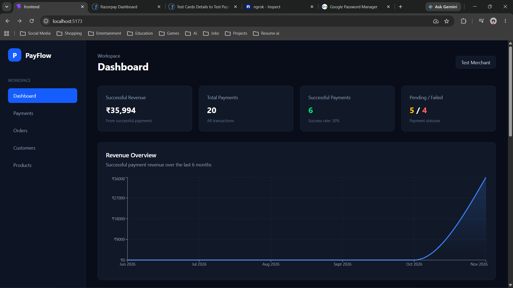
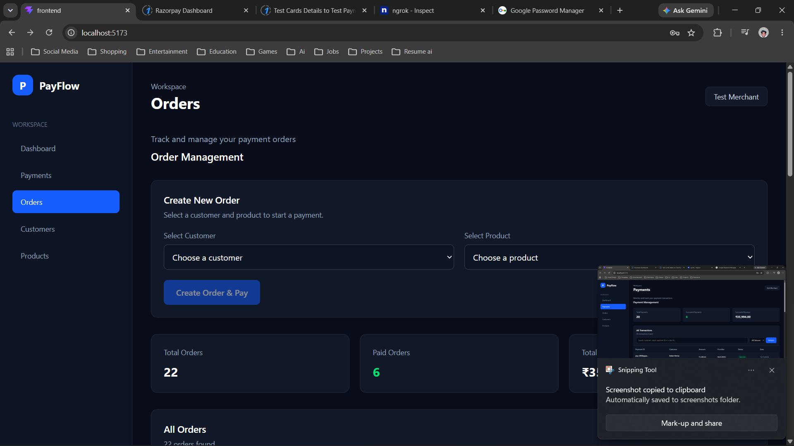
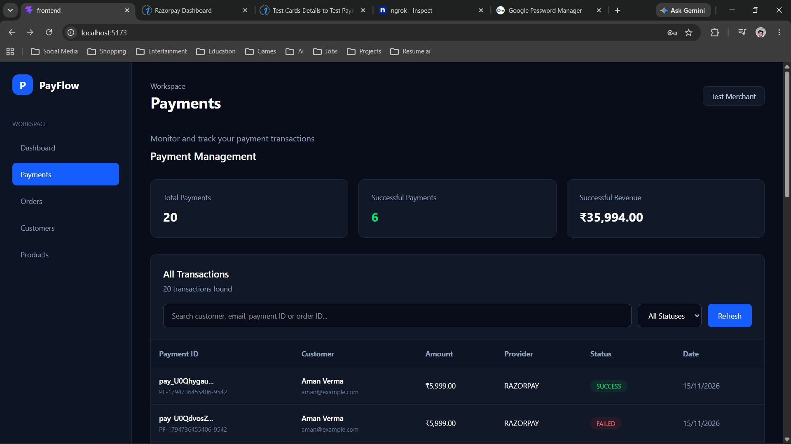
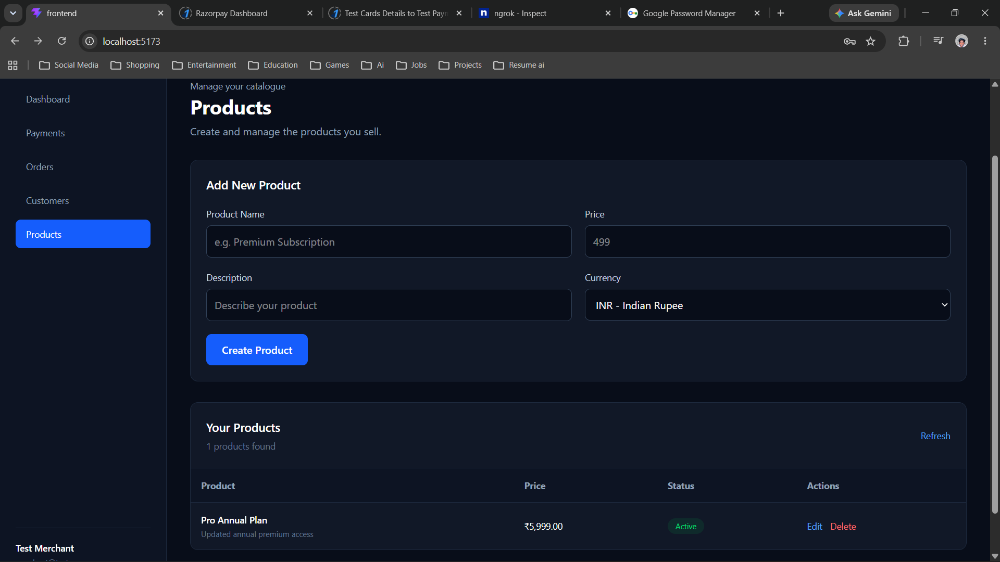
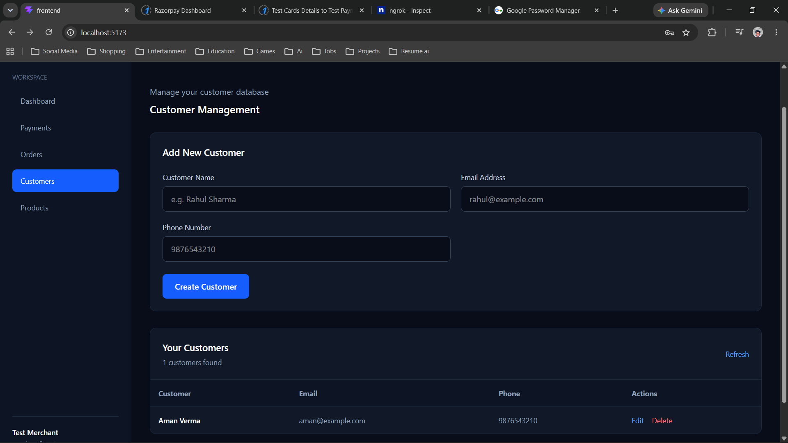

# PayFlow — Payment Management Platform

A full-stack payment management platform built to manage customers, products, orders, and payment transactions with Razorpay integration.

## Overview

PayFlow provides merchants with a centralized dashboard to manage their payment operations, monitor transaction activity, and track revenue.

## Features

- **Merchant Authentication** — Secure registration and login using JWT authentication.
- **Dashboard & Analytics** — Revenue tracking, payment statistics, success rates, and recent activity.
- **Product Management** — Create, view, update, and delete products.
- **Customer Management** — Maintain customer records.
- **Order Management** — Create and track orders with idempotency support.
- **Payment Integration** — Razorpay Test Mode checkout integration.
- **Payment Verification** — Server-side Razorpay signature verification.
- **Webhook Handling** — Process payment success and failure events with signature verification and duplicate-event protection.
- **Search & Filters** — Search and filter orders and payments by relevant fields and status.

## Screenshots

### Dashboard



### Orders



### Payments



### Products



### Customers



## Tech Stack

**Frontend**

- React
- TypeScript
- Vite
- Tailwind CSS
- Recharts

**Backend**

- Node.js
- Express.js
- TypeScript
- Prisma ORM
- PostgreSQL
- JSON Web Tokens (JWT)

**Payment Integration**

- Razorpay Test Mode
- Razorpay Webhooks

**Development Tools**

- Git and GitHub
- Postman
- VS Code
- ngrok

## Project Structure

```text
PayFlow/
├── backend/
│   ├── prisma/
│   └── src/
│       ├── config/
│       ├── controllers/
│       ├── middleware/
│       ├── routes/
│       ├── services/
│       └── utils/
│
├── frontend/
│   └── src/
│       └── components/
│
├── screenshots/
└── README.md
```

## Getting Started

### Prerequisites

- Node.js and npm
- PostgreSQL
- Razorpay Test Mode account

### 1. Clone the repository

```bash
git clone https://github.com/ChronosCreator/PayFlow.git
cd PayFlow
```

### 2. Set up the backend

```bash
cd backend
npm install
```

Create a `.env` file inside `backend/`:

```env
PORT=5000
DATABASE_URL="your_postgresql_connection_string"
JWT_SECRET="your_jwt_secret"
RAZORPAY_KEY_ID="your_razorpay_key_id"
RAZORPAY_KEY_SECRET="your_razorpay_key_secret"
RAZORPAY_WEBHOOK_SECRET="your_webhook_secret"
```

Apply database migrations and generate the Prisma Client:

```bash
npx prisma migrate deploy
npx prisma generate
```

Start the backend:

```bash
npm run dev
```

### 3. Set up the frontend

Open another terminal:

```bash
cd frontend
npm install
```

Create a `.env` file inside `frontend/`:

```env
VITE_RAZORPAY_KEY_ID="your_razorpay_key_id"
```

Start the frontend:

```bash
npm run dev
```

Open the local URL displayed by Vite, usually `http://localhost:5173`.

## API Modules

| Module         | Main endpoints                                                   |
| -------------- | ---------------------------------------------------------------- |
| Authentication | `/api/auth/register`, `/api/auth/login`                          |
| Products       | `/api/products`                                                  |
| Customers      | `/api/customers`                                                 |
| Orders         | `/api/orders`                                                    |
| Payments       | `/api/payments`, `/api/payments/verify`, `/api/payments/webhook` |
| Analytics      | `/api/analytics`                                                 |

Protected endpoints require a JWT bearer token.

## Payment Testing

PayFlow currently integrates Razorpay in **Test Mode**. Test transactions and webhook events are used to verify payment processing. No real-money transactions are intended by this configuration.

## Security Notes

- Environment files and credentials should never be committed.
- Payment signatures are verified on the backend.
- Webhook signatures are validated before processing.
- Duplicate webhook events are protected against using unique event IDs.

## Future Improvements

- Production deployment and live payment configuration.
- Automated testing and integration test coverage.
- Improved payment reconciliation and monitoring.
- Role-based access control.
- Enhanced reporting and exports.

## Author

**Sumit Kumar**

B.Tech — Computer Science and Engineering

GitHub: [ChronosCreator](https://github.com/ChronosCreator)

---

_PayFlow is a portfolio project developed for learning and demonstrating full-stack development and payment integration concepts._
